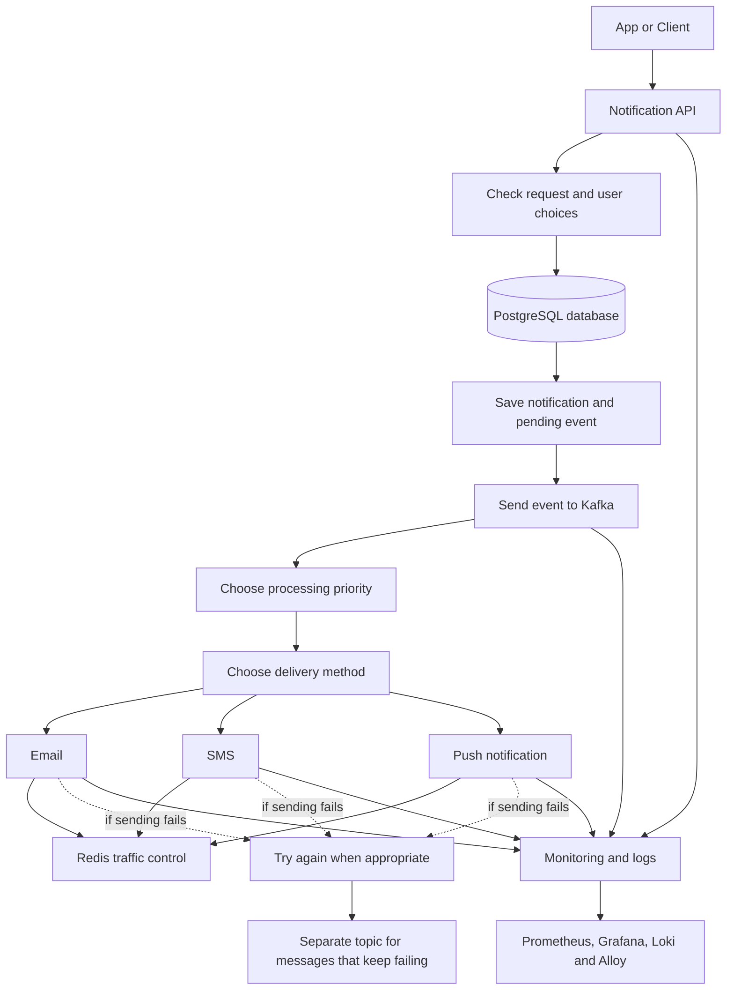

<div align="center">

# Scalable Notification Delivery System

### End-to-end notification processing with reliability, monitoring, and background delivery

A Java and Spring Boot backend that receives notification requests, saves them in PostgreSQL, and processes them asynchronously with Kafka.

</div>

> **Project goal:** process notifications reliably, reduce duplicate sends, handle temporary failures, and make system behaviour easier to monitor.

<details>
<summary><strong>Project overview — open to view</strong></summary>

| Area | What it does |
|---|---|
| API | Receives notification requests and checks that the details are valid |
| Database | Saves notification details and user choices |
| Templates | Keeps message content separate from the sending process |
| Notification types | Supports `EMAIL`, `SMS`, and `PUSH` |
| Notification categories | Supports `TRANSACTIONAL` and `PROMOTIONAL` |
| Background processing | Uses Kafka to process notifications outside the initial API request |
| Duplicate prevention | Helps stop the same request from being processed repeatedly |
| Safe event publishing | Saves work that still needs to be sent to Kafka |
| Traffic control | Uses Redis to help control how quickly work is processed |
| Failure handling | Retries certain failures and sends repeatedly failing messages to a separate topic |
| Monitoring | Uses Prometheus, Grafana, Loki, and Grafana Alloy to inspect system activity |
| Development tools | Uses Docker Compose, Postman, and GitHub Actions |

</details>

## 🏗️ System Architecture


The architecture shows how a request moves through the API, database, Kafka priority consumers, delivery channels, retry handling, Redis rate limiting, monitoring, and deployment.

### How it works



<details>
<summary><strong>Step-by-step request journey</strong></summary>

1. An app or another service sends a notification request.
2. The API checks that the request is valid.
3. The system checks the user's preferences and the suitable message template.
4. The notification is saved in PostgreSQL.
5. The system also saves a record of the work that needs to be sent to Kafka.
6. A background process sends that saved work to Kafka.
7. Kafka sends the work to the correct priority-processing path.
8. The system chooses the delivery method: email, SMS, or push.
9. Redis helps control how quickly notifications are processed.
10. If a temporary problem occurs, the system can try again. Messages that continue to fail can be moved to a separate topic for investigation.
11. Monitoring tools help you inspect activity and find problems.

**Important:** receiving a request does not necessarily mean the notification has already been delivered. Sending happens in the background.

</details>

## 🚀 Features

<details open>
<summary><strong>1. Receiving and saving requests</strong></summary>

- A Java and Spring Boot API accepts notification requests.
- Invalid requests can be rejected before they enter the processing flow.
- PostgreSQL stores notification details.
- User preferences help determine which notification methods are allowed.
- Message templates keep the content separate from the code that processes notifications.
- Centralized error handling helps return clearer responses when something goes wrong.

The initial project supports three delivery methods and two categories:

| Delivery method | Category examples |
|---|---|
| `EMAIL` | `TRANSACTIONAL`, `PROMOTIONAL` |
| `SMS` | `TRANSACTIONAL`, `PROMOTIONAL` |
| `PUSH` | `TRANSACTIONAL`, `PROMOTIONAL` |

This gives six possible method/category combinations. The system's rules and the user's preferences determine which combination is used.

</details>

<details>
<summary><strong>2. Processing in the background with Kafka</strong></summary>

Kafka lets the API accept and save a request without having to finish all the notification work immediately.

The project uses three priority topics:

- `notification.priority.high`
- `notification.priority.medium`
- `notification.priority.low`

A **topic** is a named place where Kafka stores messages for other parts of the application to read.

The project also uses separate consumer logic to process work. A **consumer** is a part of the application that reads messages from Kafka and acts on them.

**Priority and category are different:** `high`, `medium`, and `low` describe how urgently work should be processed. `TRANSACTIONAL` and `PROMOTIONAL` describe the purpose of a notification.

</details>

<details>
<summary><strong>3. Preventing duplicate notifications</strong></summary>

The system uses an idempotency key—a stable identifier for a particular request—to help recognise when the same logical notification is submitted again.

The database also enforces uniqueness rules. This matters because two requests can arrive at almost the same time. Checking for a duplicate in application code alone is not enough to prevent every race between requests.

The aim is to avoid sending the same notification more than once when requests or messages are repeated. Background systems can still repeat work, so each processing step must handle duplicates carefully.

</details>

<details>
<summary><strong>4. Saving work before sending it to Kafka</strong></summary>

The project uses the **Transactional Outbox** approach to reduce the chance that a notification is saved in the database but its Kafka message is forgotten.

In simple terms, the application saves the notification and a record of the event that needs publishing together. A separate process then sends that event to Kafka.

The Outbox record includes these fields:

| Field | Plain-English meaning |
|---|---|
| `eventId` | Unique ID for this event |
| `notificationEventId` | ID linking the event to its notification |
| `payload` | The event's saved information |
| `status` | Whether the event is waiting, sent, or in another configured state |
| `createdAt` | When the event record was created |
| `publishedAt` | When the system recorded that it was sent |

The exact status names and field types depend on the code in the repository.

</details>

<details>
<summary><strong>5. Controlling traffic and handling failures</strong></summary>

- **Redis traffic control:** helps prevent too much work from being processed at once, using shared counters or state.
- **Retry:** gives the system another chance when a problem is temporary.
- **Separate failure topic:** keeps messages that continue to fail so they can be investigated.
- **Resilience4j:** provides settings that can limit repeated attempts, pause calls to a failing dependency, or limit how much work runs at once.

Retries should be limited. For example, a temporary network problem might be worth retrying, but an invalid request usually will not become valid by trying again. Repeating a send can also create duplicates unless the system handles that case safely.

</details>

## 📨 Kafka topics

| Topic | Purpose |
|---|---|
| `notification.priority.high` | Work that should be handled with high priority |
| `notification.priority.medium` | Work with medium priority |
| `notification.priority.low` | Work with low priority |
| Configured failure topic | Messages that could not be processed after the allowed attempts |

The exact name of the failure topic depends on the project's configuration. Check the application settings before using a specific name.

<details>
<summary><strong>Kafka setup checklist</strong></summary>

- [ ] The application connects to the correct Kafka broker.
- [ ] Producer and consumer use compatible message formats.
- [ ] The topic names match in the producer and consumer settings.
- [ ] The consumer group is set as intended.
- [ ] The consumer is subscribed to the right topic.
- [ ] The retry and failure-topic settings match the code.
- [ ] Kafka addresses work from the place the application is running.

**Consumer group** means a set of consumers that share the work of reading a topic. **Offset** means the position a consumer has reached in a topic. Setting `auto-offset-reset=earliest` can help a new consumer group start from older messages, but it does not reset a group that already has saved progress.

</details>

## ⚙️ Configuration and setup

Configuration can vary between local development, testing, and deployment. Keep passwords and private keys out of this README and source control.

<details>
<summary><strong>Spring Boot settings</strong></summary>

The application configuration needs values for the database, Kafka, and Redis. The following is an example of the kinds of values to configure; use the actual property names supported by the project's Spring Boot version.

```properties
# Database
spring.datasource.url=${DB_URL}
spring.datasource.username=${DB_USERNAME}
spring.datasource.password=${DB_PASSWORD}

# Kafka
spring.kafka.bootstrap-servers=${KAFKA_BOOTSTRAP_SERVERS}
spring.kafka.consumer.group-id=${KAFKA_CONSUMER_GROUP}
spring.kafka.consumer.auto-offset-reset=earliest

# Redis
spring.data.redis.host=${REDIS_HOST}
spring.data.redis.port=${REDIS_PORT}
```

These placeholders must be supplied by your local environment. Do not paste real passwords into the README.

</details>

<details>
<summary><strong>PostgreSQL and Docker</strong></summary>

- PostgreSQL runs in Docker for local development.
- If the application runs directly on your computer, it usually connects through a published port.
- If the application runs inside Docker Compose, it usually connects using the database service name and its container port.
- Check the database name, username, password, driver, schema, and timezone settings.
- Make sure services that need to communicate are connected to the same Docker network.

Common issues encountered during development included database-driver or authentication mismatches, timezone errors, missing tables, and stale database state. Check configuration and transaction boundaries before changing application logic.

</details>

<details>
<summary><strong>Monitoring tools</strong></summary>

The project uses two main monitoring paths:

**Numbers and performance**

`Spring Boot Actuator + Micrometer → Prometheus → Grafana`

- Actuator exposes configured health and monitoring endpoints.
- Micrometer records application measurements.
- Prometheus collects and stores those measurements.
- Grafana displays them in dashboards.

**Application logs**

`Application logs → Grafana Alloy → Loki → Grafana`

- Alloy collects and forwards logs.
- Loki stores the logs so they can be searched.
- Grafana lets you view the logs and compare them with the performance measurements.

Checklist:

- [ ] Prometheus, Grafana, Loki, and Alloy can reach one another on the intended Docker network.
- [ ] Prometheus can reach the application's metrics endpoint.
- [ ] Alloy can read the configured log source and send logs to Loki.
- [ ] Grafana data sources use addresses reachable from the Grafana container.
- [ ] Logs do not expose passwords, private keys, or sensitive notification content.

</details>

<details>
<summary><strong>Resilience4j settings</strong></summary>

When setting up failure handling, check that:

- [ ] Retries are limited and used for temporary failures.
- [ ] Repeated calls stop when a dependency is clearly unhealthy.
- [ ] Limits prevent one slow dependency from using all available capacity.
- [ ] The system records when retries or failure handling occur.
- [ ] A failed notification is not reported as successfully delivered.
- [ ] Repeating an operation cannot accidentally send duplicate messages.

Some Resilience4j annotations work through Spring's proxy mechanism. Calling an annotated method from another method in the same class may bypass those protections. Verify the behaviour with tests.

</details>

## 🔭 Monitoring

| Tool | What you use it for |
|---|---|
| Spring Boot Actuator | Check configured health and monitoring endpoints |
| Micrometer | Record application measurements |
| Prometheus | Collect performance measurements |
| Grafana | View dashboards and logs |
| Grafana Alloy | Collect and forward logs |
| Grafana Loki | Store and search logs |

Useful things to watch include API errors, request response times, Kafka processing delays, failed messages, pending Outbox records, Redis rate-limit rejections, and application health.

## 🚀 Run and test

Use the repository's actual Compose file, build files, and application settings for exact commands.

<details>
<summary><strong>Local run checklist</strong></summary>

1. Install the Java version required by the project and Docker.
2. Set local configuration values for PostgreSQL, Kafka, and Redis.
3. Start the required services using the project's Docker Compose file.
4. Check that the containers are running and can communicate.
5. Start the Spring Boot application using the repository's build tool.
6. Check the health endpoint if it is enabled.
7. Send a test request using Postman.
8. Check that the notification was saved in PostgreSQL.
9. Confirm that the event reached Kafka and that the consumer processed it.
10. Open Grafana to inspect measurements and logs if the monitoring services are running.

</details>

<details>
<summary><strong>GitHub Actions CI checks</strong></summary>

The GitHub Actions workflow automatically runs the checks defined in the repository when changes are pushed or a pull request is opened. These checks may include compiling the code, running tests, and packaging the application.

A successful run means those configured checks passed. It does not automatically guarantee that every service works correctly under real-world traffic.

</details>

## 🧰 Troubleshooting

<details>
<summary><strong>Kafka messages are not being processed</strong></summary>

1. Confirm the producer and consumer use the same topic name.
2. Check the consumer group and listener settings.
3. Check that the message format matches what the consumer expects.
4. Look at the application logs for startup or processing errors.
5. Make sure the Kafka address works from where the application runs.
6. Check whether the consumer has already saved its reading position.
7. Check whether failed messages are being retried or sent to the failure topic.

</details>

<details>
<summary><strong>Kafka connection errors or NotCoordinatorException</strong></summary>

Check that Kafka is running, its advertised addresses are correct, and the application uses the right address for its environment. Containers should use the appropriate internal service address; applications running on the host should use the published host address.

</details>

<details>
<summary><strong>PostgreSQL errors</strong></summary>

Check the connection URL, driver, credentials, timezone, database name, table creation, and schema. For errors involving old or conflicting data, check transaction boundaries and whether multiple requests are updating the same record.

</details>

<details>
<summary><strong>Monitoring data or logs are missing</strong></summary>

- Check that the application's monitoring endpoints are enabled.
- Confirm Prometheus can reach the application.
- Check Grafana's data-source addresses.
- Confirm Alloy can read logs and reach Loki.
- Check that all required containers are running and connected to the right network.

</details>

## 🧭 Development journey
<details>
<summary><strong>View phase summary</strong></summary>

| Phase | What was added or learned |
|---|---|
| 1 | API for receiving notification requests |
| 2 | Saving notification data in PostgreSQL |
| 3 | User preferences and message templates |
| 4 | Background processing with Kafka |
| 5 | Priority-based processing and channel workers |
| 6 | Retrying failed work and handling messages that keep failing |
| 7 | Rate limiting with Redis |
| 8 | Preventing duplicate requests and processing |
| 9 | Saving pending events with notification data before publishing to Kafka |
| 10 | Not marked complete |
| 11 | Monitoring measurements and application logs |
| 12 | Improving failure handling, running services with Docker, and automated CI checks |

These phase names summarise the journey from the project context. Confirm exact implementation details against the current repository.

</details>

## 🧠 What this project demonstrates

- Accepting requests and saving data with Java and Spring Boot.
- Processing notification work in the background with Kafka.
- Using PostgreSQL to keep notification data.
- Reducing duplicate work.
- Keeping track of events that still need to be published.
- Controlling processing speed and handling temporary failures.
- Collecting measurements and logs to understand system behaviour.
- Running supporting services with Docker and checking code with GitHub Actions.

## 🧭 Reference Links / Learning Materials
- https://medium.com/@issa.khodadadi88/implementing-kafka-producer-and-consumer-in-spring-boot-75796f0ce242
- https://medium.com/@AlexanderObregon/using-spring-boot-with-postgresql-for-data-persistence-49e843ab46fc
- https://stackoverflow.com/questions/37694987/connecting-to-postgresql-in-a-docker-container-from-outside
- https://medium.com/@AlexanderObregon/integrating-spring-boot-with-kafka-for-messaging-8bd07e76b038 
- https://docs.spring.io/spring-boot/reference/messaging/kafka.html
- https://medium.com/@issa.khodadadi88/implementing-kafka-producer-and-consumer-in-spring-boot-75796f0ce242
- https://gemini.google.com/app/107d503e2e5fcde5
- https://github.com/Rapter1990/ratelimiter/blob/main/src/main/java/com/springboot/ratelimiter/user/service/impl/RateLimiterServiceImpl.java
- https://www.innoq.com/en/blog/2024/03/distributed-rate-limiting-with-spring-boot-and-redis/ --> Using Bucket4j algorithm.
- https://docs.spring.io/spring-data/redis/reference/redis/getting-started.html
- https://medium.com/@arun.badhai/rate-limiter-token-bucket-f6ecd33692f2
- https://medium.com/simform-engineering/revolutionize-monitoring-empowering-spring-boot-applications-with-prometheus-and-grafana-e99c5c7248cf
- https://oneuptime.com/blog/post/2026-01-26-custom-micrometer-metrics-spring-boot/view
- https://factorhouse.io/articles/dead-letter-queues-kafka/
- https://oneuptime.com/blog/post/2026-02-01-spring-boot-distributed-tracing/view
- https://medium.com/@bectorhimanshu/logging-and-monitoring-in-springboot-with-loki-and-visualizing-loki-logs-in-grafana-f15bad714996
- https://grafana.com/docs/opentelemetry/collector/grafana-alloy/
- https://medium.com/garantibbva-teknoloji/applying-the-five-most-used-resiliency-patterns-using-resilience4j-with-spring-boot-1cc695988d
- https://www.baeldung.com/resilience4j
